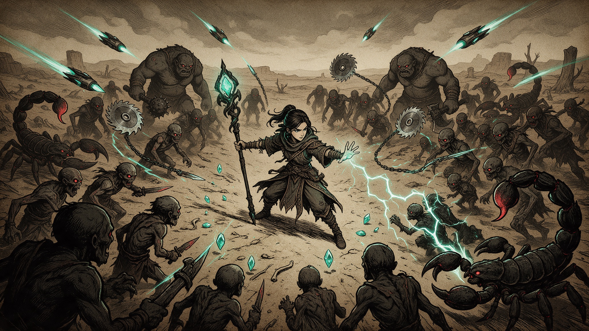

# 2D Survivors Roguelike

A survivors-like action roguelite template for Summer Engine: weapons fire themselves, you dodge, level up and draft upgrades until the screen is yours.

## What's inside

- **Automatic weapons**: homing missiles, wall-bouncing shots, orbiting saw blades and chain lightning. Weapons are data-driven `WeaponDef` resources in `resources/weapons/`.
- **Upgrade draft**: pick one of three cards on every level-up, from a pool of eleven upgrades that stack and unlock each other.
- **Endless enemy waves** that spawn faster as you level, with three enemy types, knockback, damage numbers and camera shake.
- **A telegraphed boss** that returns every two minutes and scales with you: charges, jumps and projectile barrages.
- **Two playable characters**, the Mage and the Knight, with different health, speed, starting weapons and an exclusive upgrade.
- **Touch support** with a floating on-screen joystick, and a hand-drawn gothic woodcut look documented in `.summer/art-bible.md`.

## Get started

1. Download this repo as a [ZIP](https://github.com/SummerEngine/template-2d-vampire-survivor-roguelike/archive/refs/heads/main.zip) or clone it.
2. Open the folder in [Summer Engine](https://www.summerengine.com/download).
3. Press Play. The game boots into the main menu, then character select.

Summer's AI agent can extend the game for you. Try:

- "Add a frost aura weapon that slows every enemy near the player."
- "Add a third character, a ranger who starts with piercing arrows."
- "Save the best survival time and show it on the main menu."

## Controls

| Action | Input |
|--------|-------|
| Move | W A S D or arrow keys, or the on-screen joystick on touch screens |
| Attack | Automatic |
| Pause | Esc |
| Restart after death | R |
| Debug: force a level-up / spawn the boss | L / B |

## How it fits together

| File | Job |
|------|-----|
| `scenes/main_menu.tscn` → `scenes/character_select.tscn` → `main.tscn` | Scene flow (the gameplay scene sits at the repo root) |
| `scripts/player.gd` | Movement, health, i-frames, character setup |
| `scripts/weapon_system.gd`, `scripts/weapon_def.gd` | Auto-firing weapons and their data |
| `scripts/saw_system.gd`, `scripts/lightning_system.gd` | Orbiting saws and chain lightning |
| `scripts/main.gd` | The upgrade pool (`UPGRADES`), pause menu and game over |
| `scripts/level_system.gd`, `scripts/xp_gem.gd` | XP curve and gems |
| `scripts/enemy_spawner.gd`, `scripts/enemy.gd` | Spawning and enemy behaviour |
| `scripts/boss_system.gd`, `scripts/boss.gd` | Boss timing and its state machine |
| `scripts/run_state.gd` | The two characters |
| `scripts/sfx.gd` | Pooled sound effects (the only autoload) |

To add content, add a `WeaponDef` resource, extend the `UPGRADES` array in `scripts/main.gd`, or add an enemy scene that uses `scripts/enemy.gd`.

## License

MIT, see [LICENSE](LICENSE).
